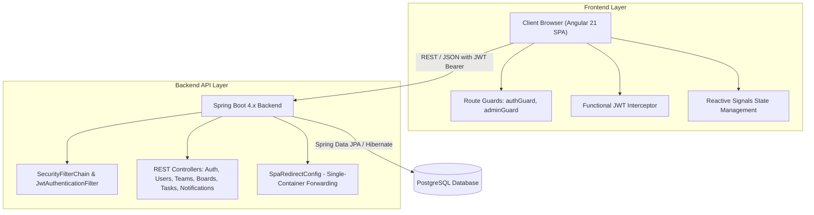

# Taskly - Collaborative Task & Workspace Management System

[](https://www.oracle.com/java/)
[](https://spring.io/projects/spring-boot)
[](https://angular.dev/)
[](https://www.typescriptlang.org/)
[](https://www.postgresql.org/)

Taskly is a modern, full-stack collaborative Task Management System (TMS) engineered for agile teams and organizations to manage project workflows, track deliverables, balance team workloads, and visualize upcoming deadlines.

Architected with a decoupled Spring Boot REST backend and an Angular reactive single-page client, Taskly is designed both for modular local development and unified single-container deployment (e.g., on Railway, Render, or Docker).

---

## Architecture Overview



---

## Key Features

### 1. Interactive Kanban Workspace
* **Flexible Column Management:** Create, rename, reorder, or delete custom workflow columns.
* **Task Card Management:** Create tasks with rich descriptions, priorities (Low, Medium, High), due dates, and assignees.
* **Drag-and-Drop Workflow:** Move tasks smoothly between workflow stages.
* **Quick Filters & Search:** Filter board cards instantly by priority chips (All, High, Medium, Low) or live title/description search.
* **Batch Column Sweep:** Clear or sweep all completed tasks in a column with one click.
* **One-Click CSV Export:** Export board task data into standard RFC-4180 CSV format for reporting and spreadsheets.

### 2. Smart Due Date Intelligence & Calendar
* **Relative Countdown Badges:** Visual due date indicators (`Today`, `Tomorrow`, `In Xd`, `Overdue`, `Done`) across board and list views.
* **Deadline Calendar:** Dynamic visual schedule cards plotted from real-time database deadlines with status filtering (`All`, `Upcoming`, `Overdue`, `Completed`).

### 3. Analytics & Workload Monitoring
* **Personal KPI Metrics:** Real-time counters for Total Assigned Tasks, In-Progress Tasks, Completed Deliverables, and Completion Rate.
* **Team Workload Roster:** Live progress bars and active task tallies per team member to balance workload distribution.
* **Recent Activity Feed:** Computed human-readable audit log tracking task creation, progress updates, and completions.

### 4. Role-Based Access Control (RBAC) & Administration
* **System Administrators:** Dedicated admin dashboard with live user search, role filter chips (All, Admins, Standard Users), and toggleable administrative privileges.
* **Team Owners:** Authority to manage member rosters and delete owned teams.
* **Standard Members:** Access to team boards, personal task views, and team join requests.

### 5. Team Join Requests & Notification Center
* **Join Requests:** Non-members can request access to existing teams with targeted administrator notifications.
* **Notification Dropdown:** Real-time alert center in the top navigation with:
  * Filter tabs (`Unread` vs. `All`).
  * In-line quick approval or denial with reason prompts.
  * One-click "Mark All as Read" and "Clear Read" controls.

### 6. Authentication & User Customization
* **Secure Auth Experience:** Registration and login with real-time password strength meter, password confirmation validation, show/hide password toggle, and "Remember Me" credentials persistence.
* **Avatar Accent Customization:** Personalized avatar colors persisted in client storage across top headers and profile cards.
* **Default Landing View Preference:** Configure whether Taskly opens to the Dashboard, Kanban Boards, My Tasks, Calendar, or Reports.
* **Design System:** Royal Blue palette (`#3447AA`), glassmorphism card surfaces, custom floating toasts, and confirmation dialogs with no native browser alert popups.

---

## Technology Stack

### Backend
* **Language & Runtime:** Java 21
* **Framework:** Spring Boot 4.x (`spring-boot-starter-webmvc`, `spring-boot-starter-data-jpa`)
* **Security:** Spring Security with stateless JWT (JSON Web Token via JJWT `0.11.5`)
* **Validation:** Jakarta Validation API
* **Database Driver & ORM:** PostgreSQL Driver with Hibernate
* **Build Tool:** Apache Maven

### Frontend
* **Framework:** Angular 21 (Standalone Components, Signals API)
* **Routing & Guards:** Angular Router with `authGuard` and `adminGuard`
* **HTTP:** Angular `HttpClient` with functional `jwtInterceptor`
* **Styling:** Vanilla CSS with design tokens, glassmorphism, and responsive breakpoints
* **Package Manager:** npm

---

## Project Structure

```text
TMS/
├── Taskly Backend/                 # Spring Boot REST API
│   ├── src/main/java/com/Task_Management_System/TMS/
│   │   ├── config/                 # SPA redirection and routing configuration
│   │   ├── controller/             # REST controllers (Auth, User, Team, Board, Task, Notifications, etc.)
│   │   ├── dto/                    # Request and response DTO schemas with validation
│   │   ├── exception/              # Global exception handler & custom exceptions
│   │   ├── model/                  # JPA entities (User, Team, TeamMember, Board, TaskList, Task, Notification)
│   │   ├── repository/             # Spring Data JPA repositories
│   │   ├── security/               # JWT token provider, filters, and SecurityFilterChain
│   │   └── service/                # Business logic contracts and implementations
│   └── src/main/resources/
│       ├── application.properties  # Database connection, port binding, and Hibernate configuration
│       └── static/                 # Production-built Angular bundle for monolithic deployment
│
└── Taskly Frontend/                # Angular Single Page Application
    ├── src/app/
    │   ├── core/                   # Interceptors, guards, models, and shared HTTP services
    │   ├── features/               # Feature views (login, register, dashboard, admin)
    │   └── app.routes.ts           # Client route definitions
    ├── angular.json                # Angular CLI configuration and asset budgets
    └── package.json                # Frontend dependencies and npm scripts
```

---

## Prerequisites

Before setting up Taskly locally, make sure you have:
* **JDK 21** installed and configured in your `PATH`
* **Node.js** (v18.x or v20.x+) & **npm**
* **Maven 3.8+** (or use the Maven wrapper if available)
* **PostgreSQL 14+** running locally or a cloud database instance (e.g., Supabase, Neon, Railway)

---

## Environment Variables

| Variable | Default Value | Description |
| :--- | :--- | :--- |
| `PORT` | `8080` | Server listening port |
| `DATABASE_HOST` | `localhost` | PostgreSQL host address |
| `DATABASE_PORT` | `5432` | PostgreSQL port |
| `DATABASE_NAME` | `task_mgt_db` | Target PostgreSQL database name |
| `DATABASE_USER` | `postgres` | Database username |
| `DATABASE_PASSWORD` | `123` | Database user password |

---

## Getting Started Locally

### 1. Database Setup
Create a PostgreSQL database:
```sql
CREATE DATABASE task_mgt_db;
```

Update your connection credentials in `Taskly Backend/src/main/resources/application.properties` (or set the environment variables listed above):
```properties
spring.datasource.url=jdbc:postgresql://${DATABASE_HOST:localhost}:${DATABASE_PORT:5432}/${DATABASE_NAME:task_mgt_db}
spring.datasource.username=${DATABASE_USER:postgres}
spring.datasource.password=${DATABASE_PASSWORD:your_password}
```

### 2. Run the Backend API
From the repository root:
```bash
cd "Taskly Backend"
mvn spring-boot:run
```
The REST API will start on **`http://localhost:8080`**.

### 3. Run the Frontend Client
In a separate terminal window:
```bash
cd "Taskly Frontend"
npm install
npx ng serve
```
Access the client application at **`http://localhost:4200`**.

---

## Monolithic Production Build & Deployment

Taskly can be packaged into a single deployable Spring Boot JAR containing the compiled Angular frontend. This eliminates CORS overhead in production and allows single-service hosting on platforms like **Railway**.

### Step 1: Build the Frontend
```bash
cd "Taskly Frontend"
npx ng build --configuration production
```
The compiled artifacts will be output to `Taskly Frontend/dist/taskly-frontend/browser`.

### Step 2: Copy Assets to Backend Static Directory
* **Windows (PowerShell):**
  ```powershell
  Remove-Item -Recurse -Force "..\Taskly Backend\src\main\resources\static\*"
  Copy-Item -Recurse -Force "dist\taskly-frontend\browser\*" "..\Taskly Backend\src\main\resources\static\"
  ```
* **macOS / Linux:**
  ```bash
  rm -rf "../Taskly Backend/src/main/resources/static/"*
  cp -r dist/taskly-frontend/browser/* "../Taskly Backend/src/main/resources/static/"
  ```

### Step 3: Package the Spring Boot Executable JAR
```bash
cd "Taskly Backend"
mvn clean package -DskipTests
```
The resulting JAR in `target/TMS-0.0.1-SNAPSHOT.jar` serves both the REST endpoints under `/api/**` and the Angular client for all other web routes via `SpaRedirectConfig`.

### Step 4: Deploying to Cloud Providers (e.g, Railway)
1. Link your GitHub repository to Railway.
2. Provide the required environment variables:
   * `DATABASE_HOST`, `DATABASE_PORT`, `DATABASE_NAME`, `DATABASE_USER`, `DATABASE_PASSWORD` (or `DATABASE_URL`)
   * `PORT` (assigned automatically by the platform)
3. The server will bind to the cloud environment port and serve the full workspace under a single secure domain.

---

## REST API Overview

| Method | Endpoint | Description | Access |
| :--- | :--- | :--- | :--- |
| `POST` | `/api/auth/login` | Authenticate user credentials and receive JWT | Public |
| `POST` | `/api/users` | Register a new user account | Public |
| `GET` | `/api/users` | Retrieve all registered users | Authenticated |
| `PATCH` | `/api/users/{id}/admin` | Promote or demote user administrator status | Admin Only |
| `GET` | `/api/teams` | List all teams | Authenticated |
| `POST` | `/api/teams` | Create a new team workspace | Authenticated |
| `DELETE`| `/api/teams/{id}` | Delete a team | Owner / Admin |
| `GET` | `/api/boards/{boardId}/lists` | Retrieve all column lists for a board | Authenticated |
| `POST` | `/api/lists/{listId}/tasks` | Create a task within a column | Authenticated |
| `PATCH` | `/api/tasks/{id}/status` | Update task workflow status | Authenticated |
| `DELETE`| `/api/tasks/{id}` | Delete task | Authenticated |
| `GET` | `/api/notifications` | Fetch notifications for current user | Authenticated |
| `PATCH` | `/api/notifications/read-all`| Mark all notifications as read | Authenticated |
| `DELETE`| `/api/notifications/clear-read`| Clear read notifications | Authenticated |
| `POST` | `/api/join-requests` | Submit request to join a team | Authenticated |
| `POST` | `/api/join-requests/{id}/approve` | Approve a pending join request | Admin |
| `POST` | `/api/join-requests/{id}/deny` | Deny a pending join request with reason | Admin |
